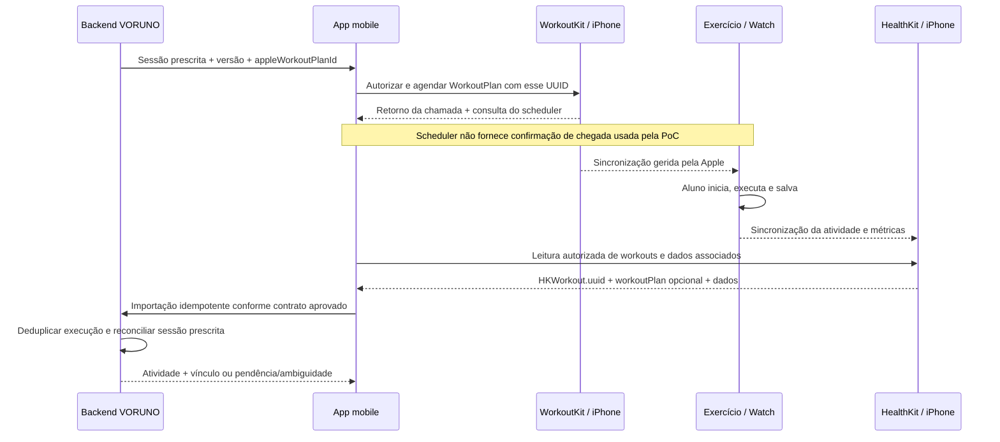

# Guia de integração Apple no aplicativo VORUNO

Documento de transferência para o agente que implementará a integração no app oficial. Referência de implementação: PoC no commit `74539a4`, com GPS e métricas detalhadas. Atualizado em 23/10/2026.

## 1. Objetivo e evidências

O fluxo é: treino sugerido pelo VORUNO → WorkoutKit no iPhone → app Exercício nativo do Watch → execução salva → HealthKit no iPhone → importação e associação no VORUNO.

O proprietário relatou funcionamento do development client, agendamento com atraso de dois segundos e leitura de corridas reais. Após a expansão de GPS/detalhes, deu retorno positivo sobre o resultado. Isso não substitui validação individual de cada métrica, identificador, cenário de erro ou dispositivo. Não foi demonstrada associação automática inequívoca de uma execução com a sessão sugerida.

Hardware informado: iPhone com iOS 26.6.1; Apple Watch SE com watchOS 26.6. Modelo do iPhone, geração do SE e build ID exato não registrados. Não prometer compatibilidade universal a partir desse teste.

O caminho de envio escolhido é **agendar**, inclusive quando a intenção é disponibilizar agora. O preview sem agendamento exibiu confirmação da Apple, mas o proprietário não encontrou o treino no Watch. Não adotar esse preview como caminho principal. Dois segundos são um horário solicitado, não prazo de entrega nem início automático do exercício.

## 2. Arquitetura no app oficial

Leia primeiro a [arquitetura mobile oficial](https://github.com/RafaNardo/Voruno/blob/main/docs/architecture/mobile-code-design.md), os contratos atuais de plano, atividade/importação, ciclo, consentimento e privacidade do projeto de destino. Este guia não cria endpoints nem substitui contratos existentes.

- Backend: dono do treino prescrito, versões, identidade da sessão, histórico de envio e atividade reconciliada.
- Mobile: consentimento, ações do usuário, conversão de contratos, chamadas aos adapters e estados visíveis.
- `WorkoutScheduling`: porta separada para capacidade, autorização, envio e remoção de agendamentos.
- `HealthActivityReading`: porta separada para autorização de leitura, atividades, métricas e percursos.
- Swift/Expo Module: fronteira do WorkoutKit. Biblioteca HealthKit: leitura nativa já disponível, isolada por adapter TypeScript.
- Reconciliador: considera identidade e evidências sem confundir envio com execução.

Encaixe sugerido na estrutura existente: telas de envio em `features/training`, importação/detalhes em `features/activities`, configuração em `features/devices`, adapters em `native/watch` e `native/healthkit`. Preserve rotas finas, design system e cache por atleta. Não copie a UI de teste nem crie camadas genéricas paralelas ao backend.



O upload ao backend acima é **trabalho do app oficial**: a PoC não envia nem persiste saúde/GPS. Só implementá-lo conforme consentimento e contrato de dados reais do projeto.

## 3. Identidade: requisito obrigatório para vincular execução e treino sugerido

**Não reutilizar o UUID fixo da PoC em produção. Não comparar `HKWorkout.uuid` com `WorkoutPlan.id`. São identidades diferentes.**

| Identidade | Significado | Regra proposta para o app oficial |
| --- | --- | --- |
| ID do template | Modelo reutilizável de treino | Não identifica a sessão prescrita ao aluno |
| `plannedSessionId` | Ocorrência concreta prescrita para um atleta | Novo para outra sessão, mesmo que os intervalos sejam iguais |
| `appleWorkoutPlanId` | UUID enviado em `WorkoutPlan(..., id:)` | Mapeado de forma persistente à sessão e ao atleta; estável em retries |
| `planRevision` | Versão do conteúdo prescrito/enviado | Preservar snapshot e histórico; não sobrescrever evidências anteriores |
| `HKWorkout.uuid` | Uma execução gravada no HealthKit | Deduplicação da atividade; duas execuções têm identidades independentes |
| `activityId` | Identidade interna da atividade importada | Resolvida idempotentemente pelo backend, não gerada de novo a cada refresh |

Se o ID canônico da sessão já for UUID e tiver a semântica correta, pode ser usado como `appleWorkoutPlanId`. Se não for, gerar um UUID uma única vez e persistir o mapeamento. Nunca gerar um UUID novo em cada toque, renderização, retry ou reinício do app. Não derivar o vínculo apenas do título, nome do aluno, data ou duração.

A PoC cria `WorkoutPlan(.custom(workout), id: fixtureID)` em Swift. Na leitura usa `workout.getWorkoutPlan()` e retém o `id` retornado. Esse método representa o `HKWorkout.workoutPlan` opcional da Apple. Os resultados **presente**, **ausente** e **falha na consulta** são distintos. A presença de um ID conhecido oferece evidência de associação ao plano; não prova que o treino foi concluído conforme prescrito nem que só houve uma execução.

### Política de envio, alteração e repetição

1. Persistir a sessão, UUID Apple e versão antes de enviar. A resposta do servidor ou armazenamento aprovado deve permitir recuperar isso após crash/logout/reinstalação, sem depender da lista do scheduler.
2. Retry ou reagendamento da mesma sessão/conteúdo conserva o UUID. Registrar tentativa, data desejada, versão e retorno observado. Chaves de idempotência devem seguir o contrato do backend.
3. Outra sessão prescrita recebe outro UUID, mesmo que copie o template anterior.
4. Alteração de conteúdo requer política explícita: manter UUID da sessão com histórico de revisões, ou gerar UUID por revisão e manter todos os aliases mapeados à mesma sessão. Se reutilizar o UUID, ele sozinho **não revela qual versão foi executada**. Não atribuir automaticamente a versão mais recente a uma execução atrasada.
5. Remover/reagendar não é uma transação atômica do SDK. Serializar, consultar estado e tratar falha entre remover e adicionar. Não apagar o mapeamento ou histórico ao remover do scheduler. Nunca usar remoção global.
6. O aluno pode executar novamente um treino que ficou disponível no Watch. Importar as duas execuções separadamente; decidir no domínio se a segunda é repetição, atividade extra ou execução a revisar. Nunca sobrescrever a primeira.

### Algoritmo proposto de reconciliação (não implementado no backend da PoC)

1. Deduplicar importação pelo escopo autenticado do atleta + provedor HealthKit + UUID da execução. Validar propriedade no servidor; não confiar em `athleteId` arbitrário enviado pelo cliente.
2. Consultar `getWorkoutPlan()` da execução. Se houver UUID conhecido e pertencente ao mesmo atleta, resolver o mapeamento para a sessão; conservar a evidência e verificar esporte, revisão/histórico e conflitos.
3. Um UUID explícito diferente do esperado não deve ser ignorado para forçar associação por horário.
4. Sem vínculo Apple utilizável, propor candidatos por sessão, esporte, data, duração e contexto. Exibir confiança/motivos; múltiplos candidatos permanecem ambíguos e precisam de resolução explícita.
5. Não bloquear uma associação por UUID válido apenas porque o aluno começou horas depois do horário previsto. A janela de ±15 minutos e tolerância de ±60 segundos são heurísticas exclusivas da fixture da PoC, não regras do produto.
6. Importar atividade e confirmar vínculo são operações distintas. A atividade pode existir sem sessão associada. Preservar proveniência, método do vínculo e possibilidade de correção auditável.
7. Só permitir associação automática baseada no UUID após validar em hardware real: UUID enviado → UUID retornado; reenvio, reagendamento, edição, repetição, sync tardio e reinício. Até lá, apresentar evidência/candidato, sem prometer correspondência exata.

Exemplo conceitual, **não DTO de endpoint já existente**:

```ts
type ApplePlanMapping = {
  plannedSessionId: string;
  appleWorkoutPlanId: string; // UUID validado
  planRevision: string;
};
type ExecutionIdentity = {
  provider: 'apple-health';
  providerWorkoutId: string; // HKWorkout.uuid, identidade da execução
  returnedApplePlanId?: string;
  planLookup: 'available' | 'absent' | 'failed';
};
```

## 4. Configuração e compilação

Baseline observada na PoC, não recomendação de upgrade obrigatório para o outro app:

| Componente | Versão/configuração |
| --- | --- |
| Expo / React Native / React | 57.0.30 / 0.86.3 / 19.2.3 |
| `@kingstinct/react-native-healthkit` | 16.2.0, MIT |
| `@react-native-healthkit/core` | 16.2.0, MIT, dependência transitiva |
| `react-native-nitro-modules` | 0.37.1, MIT |
| iOS mínimo configurado | 17.0; baseline WorkoutKit watchOS 10, com verificação runtime |
| EAS development | `developmentClient: true`, `distribution: internal`, `simulator: false` |
| Imagem EAS configurada | `macos-tahoe-26.5-xcode-26.6`; ambiente efetivamente usado precisa ser registrado |

No destino: verificar SDK/React Native/New Architecture, versões suportadas, licenças e tipos instalados. Usar `npx expo install`, lockfile e `expo-doctor`, sem copiar versões incompatíveis ou forçar resolução de peers.

```powershell
npx expo install expo-dev-client @kingstinct/react-native-healthkit react-native-nitro-modules
npx expo install --check
npx expo-doctor
npx eas-cli@latest build --platform ios --profile development
```

Usar bundle identifier, EAS project, scheme, ícone e credenciais **do aplicativo oficial**. Não copiar identidade/provisionamento da PoC. Configurar conta Apple Developer, registro do iPhone e capability HealthKit no provisionamento. Expo Go não contém esses módulos.

A configuração HealthKit da PoC usa o plugin abaixo. No app oficial, a descrição deve incluir as finalidades e categorias realmente usadas, inclusive percurso, e refletir eventual armazenamento/transmissão autorizados. Não copiar a promessa de dados somente na tela se o produto faz upload.

```ts
['@kingstinct/react-native-healthkit', {
  NSHealthShareUsageDescription: 'DESCRIÇÃO REAL E LOCALIZADA DO USO NO PRODUTO',
  NSHealthUpdateUsageDescription: false,
  background: false,
}]
```

O plugin configura `com.apple.developer.healthkit`; requests usam `toShare: []`. Não pedir escrita só para ler. Leitura de um percurso salvo não significa capturar localização ao vivo; a PoC não inicia CoreLocation nem solicita localização de background. Se o produto passar a gravar localização, isso é outro requisito/configuração.

Portar o módulo Expo local completo (`modules/voruno-apple`), incluindo registro em `expo-module.config.json`, podspec, licença e bridge. O podspec depende de ExpoModulesCore e liga WorkoutKit/HealthKit. O import HealthKit do serviço de agendamento é para enums; a leitura continua em outro adapter. Confirmar autolinking no projeto de destino; não copiar `ios/` gerado nem confiar em edição manual que o prebuild apaga.

Mudanças em Swift, módulos/bibliotecas nativos, plugins, entitlements, Info.plist, ícone/config nativa ou runtime exigem novo binário. JS/TS usando APIs já presentes pode usar Fast Refresh/OTA compatível. Na PoC GPS não exigiu rebuild porque a biblioteca já continha as APIs; a primeira integração no outro app exige build.

## 5. Implementar envio de treinos reais

O código nativo atual só aceita a fixture de cinco minutos. **Não basta copiar `scheduleTestWorkout()` para produção.** Criar contrato parametrizado adaptado ao plano real do backend: UUID Apple, versão, modalidade/local, nome, aquecimento, blocos/repetições, recuperação, desaquecimento, objetivos suportados e horário/fuso.

Validar em TypeScript e novamente na fronteira Swift: UUID, números finitos/positivos, unidades, limites de conteúdo/repetição, metas e modalidade suportadas. Não converter silenciosamente uma prescrição não suportada para outra. Consultar documentação Apple antes de adicionar assinaturas de APIs para metas de ritmo/FC, alertas ou novos esportes: não foram implementadas nesta PoC.

Fluxo nativo de referência:

1. Verificar suporte runtime e autorização WorkoutScheduler. Solicitar autorização em ação explícita.
2. Construir `CustomWorkout`, `WorkoutStep`, `IntervalStep` e `IntervalBlock`, verificando `supportsActivity` e `supportsGoal`.
3. Criar `WorkoutPlan` com o UUID persistido da sessão/mapeamento.
4. Serializar mutações, consultar agendamentos existentes e capacidade antes de enviar.
5. Converter horário para `DateComponents`, preservando segundos e fuso. Truncar para minuto causou datas passadas no teste de atraso curto. Registrar UTC do evento e data local/fuso IANA da prescrição conforme arquitetura oficial.
6. Chamar `schedule(_:at:)`. A API usada é async sem recibo de entrega; retorno significa `submitted`.
7. Consultar lista novamente e comparar UUID, conteúdo e data. PoC faz até três tentativas com 500 ms entre elas. Match significa apenas entrada confirmada no scheduler.
8. Exibir estados distintos de submissão, confirmação no scheduler e observação no Watch. Nunca marcar execução/importação a partir do envio.

Dois segundos podem ser uma opção “disponibilizar agora”, com guard de data futura e sem garantia de latência. Para planos futuros, respeitar data/fuso do produto. Não fazer retry cego de mutação quando a resposta se perde: consultar estado antes.

## 6. Coletar dados reais no HealthKit

### Autorização e consulta

`isHealthDataAvailable()` indica disponibilidade, não consentimento. `requestAuthorization()` concluído não revela quais leituras foram autorizadas; lista vazia pode ser falta de dados, acesso limitado/negado ou sincronização pendente. Manter esses estados honestos.

A PoC solicita workouts, distância, velocidade, passos, percurso, potência, passada, contato, oscilação e energia; FC é opt-in. No produto, vincular categorias à finalidade/tela e renovar pedido quando novas categorias forem introduzidas. Não inferir autorização pelo retorno de uma métrica diferente.

API de referência da biblioteca instalada:

```ts
// Exemplo de formato; acrescentar guard de plataforma, consentimento e erro sanitizado.
const workouts = await healthKit.queryWorkoutSamples({
  limit: 20,
  ascending: false,
  filter: {
    workoutActivityType: healthKit.WorkoutActivityType.running,
    date: { startDate: from, endDate: to, strictStartDate: true, strictEndDate: true },
  },
});
const workout = workouts[0];
if (workout) {
  const plan = await workout.getWorkoutPlan(); // opcional; pode falhar
  const stats = await workout.getStatistic('HKQuantityTypeIdentifierRunningPower', 'W');
  const samples = await healthKit.queryQuantitySamples('HKQuantityTypeIdentifierRunningPower', {
    unit: 'W', limit: 2001, ascending: true, filter: { workout },
  });
  const routes = await workout.getWorkoutRoutes();
  // Mapear allowlist. Não serializar/logar o proxy, plan, samples ou routes.
}
```

Este exemplo ilustra chamadas, não uma operação atômica: isolar falhas opcionais para uma ausência de GPS não apagar o resumo da corrida. A implementação completa está no adapter da PoC. Consultas de detalhes revalidam a execução por UUID, modalidade e janela antes de ler associados.

### Dicionário de dados

Prefixo dos identificadores quantitativos abaixo: `HKQuantityTypeIdentifier`.

| Dado | Tipo/API | Unidade e interpretação |
| --- | --- | --- |
| Execução | `HKWorkoutTypeIdentifier`, `queryWorkoutSamples` | UUID, modalidade, início/fim, duração gravada, fonte |
| Plano associado | `getWorkoutPlan()` | UUID do plano opcional; diferente do UUID da execução |
| Distância | `DistanceWalkingRunning` | m; soma associada, fallback total do workout se válido |
| Velocidade | `RunningSpeed` | m/s; ritmo derivado = 1000 / velocidade em s/km |
| Passos | `StepCount` | count; cadência derivada, não um campo direto de cadência |
| Frequência cardíaca | `HeartRate` | count/min, exibido como bpm; opt-in |
| Potência | `RunningPower` | W |
| Comprimento da passada | `RunningStrideLength` | m |
| Contato com solo | `RunningGroundContactTime` | ms |
| Oscilação vertical | `RunningVerticalOscillation` | cm |
| Energia ativa | `ActiveEnergyBurned` | kcal; estimativa registrada pelo dispositivo |
| Percurso | `HKWorkoutRouteTypeIdentifier`, `getWorkoutRoutes()` | latitude/longitude, tempo, altitude e precisão disponíveis na API |
| Eventos | `workout.events` | tipo e intervalo; pausas, retomadas, voltas, segmentos, marcadores |
| Proveniência | `sourceRevision.source` | nome e bundle identifier; não presumir que toda corrida veio do Watch |

Usar estatísticas associadas ao workout para média/mínima/máxima dos dados discretos e soma de energia. Consultar amostras com `filter: { workout }`, não apenas pelo intervalo de relógio: amostras simultâneas de outra fonte/atividade não devem ser atribuídas automaticamente ao treino.

Duração gravada e tempo decorrido (`endedAt - startedAt`) são distintos, especialmente com pausas. Datas de eventos em UTC; apresentação local. Unidades normalizadas na fronteira, formatação somente na UI. Rejeitar valores não finitos/unidades inesperadas; ausência não vira zero. Nunca usar `toJSON()` do proxy, pois expõe campos fora da allowlist.

### Resolução temporal e qualidade

A PoC oferece buckets de minuto decorrido, incluindo pausas. Distância/passos que cruzam limites são distribuídos proporcionalmente, assumindo uniformidade e rotulados estimados. Duplicatas por UUID são removidas; amostras distintas sobrepostas bloqueiam o cálculo conservador de distância/cadência. Cadência requer cobertura temporal completa. FC/potência/velocidade usam média aritmética das amostras que intersectam o minuto; não média ponderada por tempo. Velocidade zero não produz ritmo infinito.

Esses cálculos **não garantem equivalência aos splits do Fitness**, nem distância exata percorrida em cada segundo. Apple pode condensar séries. Antes de avaliação precisa por etapa, investigar expansão de quantity series/estatísticas por intervalos e comparar em hardware. Não reconstruir aquecimento/esforço/recuperação a partir de índices ou nomes sem evidência. Um evento lap/segment não é necessariamente uma etapa do plano; eventos de duração zero não viram intervalos inventados.

Limites atuais: últimos 14 dias/20 corridas, até 4 horas por detalhe, 2.000 amostras por série (consulta 2.001 para detectar truncamento), 200 eventos, 240 minutos. Série de velocidade/passos/FC/potência inválida ou truncada é retida como incompleta e seus cálculos ficam indisponíveis. Distância pode mostrar soma parcial com alertas. Essas escolhas protegem a PoC, não constituem estratégia de importação histórica do produto.

### GPS e altitude

O desenho usa somente dados locais, sem tiles/serviço externo. Latitude/longitude válidas, tempo dentro do treino e precisão horizontal entre 0 e 50 m. Quebrar linha em ponto rejeitado, gap >30 s, tempo não crescente, cruzamento do antimeridiano ou mudança de rota nativa. Altitude só com precisão vertical entre 0 e 30 m; altitude negativa é válida.

Processamento JS limitado a 20.000 pontos; desenho simplificado a até 500. O DTO atual conserva o traçado reduzido para exibição, **não uma rota integral adequada a exportação/análise precisa**. Altitude mínima/máxima vêm dos pontos aceitos antes da redução. Variação entre extrema não é ganho acumulado. Não calcular distância, inclinação ou aderência fina ao percurso a partir dessa geometria reduzida.

A biblioteca carrega todos os pontos nativos antes do limite JS e não oferece cancelamento/limite nessa chamada. Para produção, medir memória/latência em corridas longas e avaliar leitura nativa em lotes sob demanda. Percurso pode sincronizar depois da atividade e ser atualizado pela Apple; permitir recarregar/enriquecer sem criar outra execução. Percurso vazio não prova acesso negado.

## 7. Importação e ciclo de vida no produto

A PoC só tem leitura manual em memória. Implementar no destino, conforme contratos existentes:

- Sync incremental com anchors/checkpoints suportados pelo SDK, paginação, deduplicação e tratamento de exclusões; verificar APIs concretas antes de codificar. Janela fixa de 14 dias não resolve histórico nem sync confiável.
- Checkpoint só avança após persistência/ack correspondente. Retry idempotente não cria outra atividade; enriquecimento tardio de rota/métricas atualiza a mesma identidade.
- Estado por atleta/conta e provedor; cancelar/ignorar respostas obsoletas ao trocar conta, sair ou mudar seleção. O HealthKit do telefone não comprova que o dado pertence à conta VORUNO logada: definir consentimento e tratamento de aparelho compartilhado.
- Cache de servidor no TanStack Query conforme arquitetura, sem persistência PHI em AsyncStorage. Tokens em SecureStore; não usar SecureStore como banco de séries GPS. Persistência sensível requer desenho aprovado de criptografia, retenção e exclusão.
- Background é best-effort, não polling permanente. A PoC desabilita background delivery e limpa resultados ao sair; fluxos de background exigem configuração, requisitos e validação próprios.
- Guard de concorrência, timeout/cancelamento quando suportado e descarte de respostas tardias. Timeout de UI não prova que a operação nativa deixou de ocorrer.
- UI separa indisponível, pedido necessário, carregando, vazio, falha, parcial, importado e vínculo pendente/ambíguo. Sucesso HTTP não implica entrega Watch ou conclusão da importação assíncrona.
- Telemetria apenas códigos/capacidade/versões sanitizados. Não enviar GPS, FC, IDs pessoais, timestamps identificáveis, proxies ou erros nativos crus a console, analytics, issues ou LLM automaticamente.

## 8. Avaliar o treino do aluno

Dados disponíveis permitem investigar volume/duração, evolução de ritmo, FC/potência, cadência, dinâmica e percurso. A presença de um campo não garante qualidade suficiente para uma conclusão.

Antes de oferecer avaliação: vincular execução à sessão e à versão correta; obter segmentos reais ou declarar segmentação estimada; definir tratamento de pausas/gaps/overlaps; comparar observado com metas existentes; usar referências individuais autorizadas (por exemplo zonas/limiares quando cadastrados); definir critérios de dados insuficientes e expor proveniência.

Não atribuir cumprimento de todas as etapas pelo UUID do plano. Não atribuir nota fisiológica ou zonas com valores genéricos inventados. Não prometer acesso a todas as métricas em toda execução/Watch. O avaliador e qualquer uso de Coach/LLM pertencem ao domínio e política de dados do app oficial, fora desta PoC.

## 9. Mapa de código para reaproveitamento

| Arquivo/pasta da PoC | Uso no destino |
| --- | --- |
| `modules/voruno-apple/` | Bridge Expo/Swift e serviço WorkoutKit; substituir fixture por contrato real validado |
| `src/features/workout-scheduling/port.ts` e `adapter.ts` | Estados observáveis, validação de respostas e mensagens seguras; generalizar operações de teste |
| `src/features/health-activities/port.ts`, `adapter.ts`, `index.ts` | Porta HealthKit, lazy loader, consultas associadas, allowlist, unidade/qualidade |
| `intervals.ts`, `running-metrics.ts`, `statistics.ts` | Cálculos atuais com limites e testes; revisar precisão antes de avaliação do aluno |
| `route.ts` | Filtros e geometria reduzida para UI; não usar como pipeline integral de GPS |
| `HealthActivitiesPanel.tsx`, `WorkoutDetails.tsx`, `RouteDetails.tsx` | Referência dos estados e limpeza; redesenhar com componentes oficiais |
| `src/features/correlation/reconcile.ts` | Evidências e ambiguidade; não copiar fixture/janelas como regra de produção |
| `tests/*.test.ts` | Casos sintéticos de contratos, unidades, falhas, gaps, duplicatas e limites |
| `app.config.ts`, `eas.json` | Referência de configuração; manter identidade e runtime do app oficial |

A PoC não deve ser copiada inteira para a árvore mobile. Extrair capacidades necessárias; remover fixture, telas de debug e políticas temporárias. Manter licenças e registrar decisão de dependências.

## 10. Plano de implementação e aceitação para o agente

1. Ler instruções do destino e contratos reais. Mapear onde vivem sessão prescrita, versão, atividade, consentimento, importação e chaves de idempotência. Registrar lacunas sem inventar endpoints.
2. Implementar uma fatia vertical: capability/configuração → envio de uma sessão real com UUID persistido → build físico → leitura da execução → evidência do vínculo. Sem Watch extension até surgir necessidade concreta.
3. Validar UUID ponta a ponta em duas sessões com conteúdo igual e IDs diferentes; repetir uma sessão e verificar duas execuções com UUIDs distintos; testar retry, reagendamento, edição, remoção, reinício e sincronização tardia.
4. Implementar importação idempotente e enriquecimento tardio segundo contrato existente. Testar duplicatas, perda de resposta, exclusão/revogação, troca de conta e conflitos.
5. Adicionar detalhes sob demanda, com estados parciais, limites e qualidade. Testar corrida externa/interna, percurso ausente, HR negada, pausas, gaps e corrida longa. Comparar localmente com Fitness, respeitando métodos diferentes.
6. Testar UI/VoiceOver/Dynamic Type/contraste e telas pequenas com design system oficial. Testar foreground/background durante consultas e impedir exibição de resultado obsoleto.
7. Executar checks do destino: TypeScript, lint/format, testes, Expo Doctor/compatibilidade, export/build, testes de componentes e E2E disponíveis. Windows não compila Swift localmente; EAS valida build, hardware valida integração. macOS/Xcode pode ser necessário para debug nativo.
8. Registrar commit/build, modelos/OS, ambiente Xcode, categorias disponíveis, estado de autorização observável e resultado dos cenários sem publicar dados privados. Só declarar pronto o que foi validado.

## 11. Referências e documentos complementares

- [WorkoutKit](https://developer.apple.com/documentation/workoutkit), [WorkoutPlan](https://developer.apple.com/documentation/workoutkit/workoutplan), [WorkoutScheduler](https://developer.apple.com/documentation/workoutkit/workoutscheduler).
- [Plano opcional em HKWorkout](https://developer.apple.com/documentation/healthkit/hkworkout/workoutplan), [UUID de HKObject](https://developer.apple.com/documentation/healthkit/hkobject/uuid).
- [Autorização HealthKit](https://developer.apple.com/documentation/healthkit/authorizing-access-to-health-data), [leitura de rotas](https://developer.apple.com/documentation/healthkit/reading-route-data), [amostras condensadas](https://developer.apple.com/documentation/healthkit/accessing-condensed-workout-samples).
- [Biblioteca HealthKit](https://github.com/kingstinct/react-native-healthkit), [Expo development builds](https://docs.expo.dev/develop/development-builds/introduction/), [Expo Modules](https://docs.expo.dev/modules/overview/).
- Decisões e histórico local: [WorkoutKit](m1-workoutkit.md), [HealthKit](m2-healthkit.md), [correlação](m3-correlation.md), [GPS](gps-running-analysis.md), [riscos e evidências](risks-and-findings.md), [privacidade](privacy.md).

Os documentos de milestone incluem afirmações históricas como “M2 não implementado” ou “GPS fora de escopo”. Para transferência, usar este guia junto do código de referência e das atualizações mais recentes; não interpretar aquelas fotografias históricas como estado atual.
